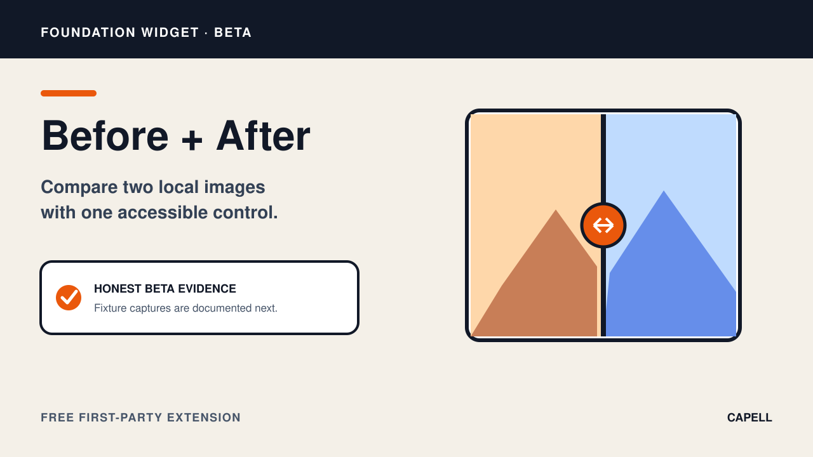
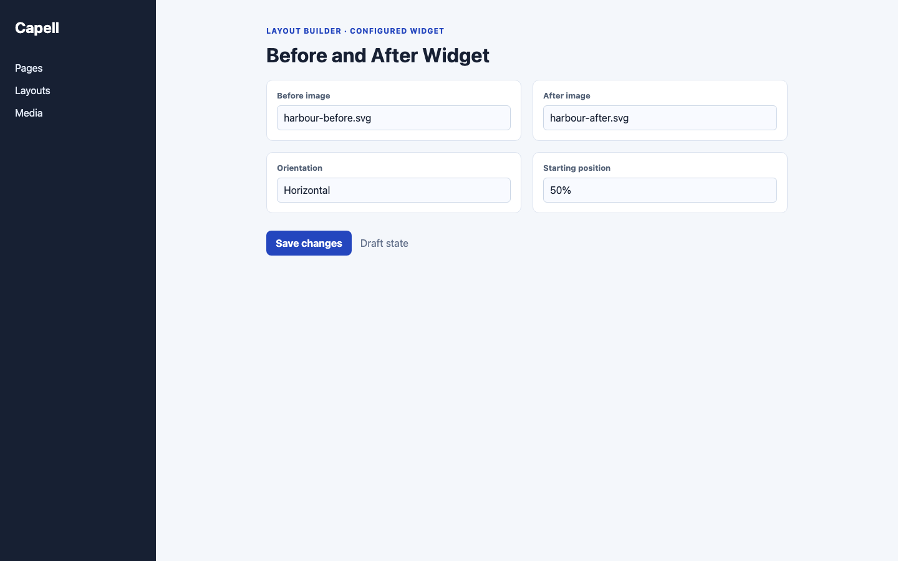

# Before and After Widget

<!-- prettier-ignore-start -->

## What This Plugin Adds

Before and After Widget is an **Available**, **No schema impact** Capell package in the **Capell Foundation** product group. It ships as `capell-app/widget-before-after` and extends these surfaces: admin, frontend.

Before and After adds a Layout Builder widget for comparing two local images with a bounded range control. The public comparison supports keyboard and touch interaction with a non-interactive fallback.

Editors select the two images and comparison settings in Layout Builder, and visitors can move the public reveal control to inspect the difference.

Evidence: [`src/Filament/BeforeAfterWidget.php`](src/Filament/BeforeAfterWidget.php), [`resources/views/widget.blade.php`](resources/views/widget.blade.php), [`tests/Feature/WidgetBeforeAfterTest.php`](tests/Feature/WidgetBeforeAfterTest.php), [`capell.json`](capell.json).

Status details:

- Status: Available
- Tier: free
- Bundle: foundation
- Composer package: `capell-app/widget-before-after`
- Namespace: `Capell\WidgetBeforeAfter`
- Theme key: not applicable

## Why It Matters

**For developers:** A typed widget definition keeps editor input, render data, and the Blade fallback behind one registered Layout Builder extension.

**For teams:** Teams can explain visual changes in one focused component without preparing separate image states or custom comparison code.

Evidence: [`src/Providers/WidgetBeforeAfterServiceProvider.php`](src/Providers/WidgetBeforeAfterServiceProvider.php), [`src/Filament/BeforeAfterWidget.php`](src/Filament/BeforeAfterWidget.php), [`tests/Feature/WidgetBeforeAfterTest.php`](tests/Feature/WidgetBeforeAfterTest.php), [`resources/views/widget.blade.php`](resources/views/widget.blade.php).

## Screens And Workflow

Screenshot contract: `docs/screenshots.json`.

- Before and After Widget extension card (marketplace, required).
- Before + After fields in Layout Builder (admin, optional).
- Before + After public output (frontend, optional).

## Technical Shape

- Service providers: `Capell\WidgetBeforeAfter\Providers\WidgetBeforeAfterServiceProvider`.
- Filament classes: `BeforeAfterWidget`.
- Data objects: `BeforeAfterInputData`, `BeforeAfterRenderData`.
- Manifest contributions: `content-widget: Capell\WidgetBeforeAfter\WidgetBeforeAfterContribution`.
- Health checks: `Capell\WidgetBeforeAfter\Health\WidgetBeforeAfterHealthCheck`.
- Blade views: `packages/widget-before-after/resources/views/widget.blade.php`.
- Cache tags: `widget-before-after`.

## Data Model

This package has no schema impact. It extends Capell through `content-widget` contributions instead of declaring package-owned tables.

## Install Impact

- Required packages: `capell-app/admin`, `capell-app/core`, `capell-app/frontend`, `capell-app/layout-builder`.
- Admin navigation: no admin page or resource contribution is declared.
- Admin/editor extensions: `content-widget: WidgetBeforeAfterContribution`.
- Permissions: none declared in `capell.json`.
- Public routes: none declared.
- Database changes: no package migrations declared.
- Config: no package config files.
- Settings: no package settings declared.
- Queues or schedules: none declared.
- Cache tags: `widget-before-after`.
- Commands: none declared.

## Common Pitfalls

- Keep required Capell packages on compatible v4 releases: `capell-app/admin`, `capell-app/core`, `capell-app/frontend`, `capell-app/layout-builder`.
- Keep public Blade and cached HTML free of authoring markers, model IDs, permissions, signed editor URLs, and lazy database queries.
- Custom write integrations must preserve invalidation for `widget-before-after` cache tags.

## Troubleshooting

| Symptom | Likely cause | Check | Fix |
| --- | --- | --- | --- |
| Package surface is missing after install | Provider or manifest is not loaded | Confirm `capell.json`, package `composer.json`, and provider registration | Reinstall the package, refresh Composer autoload, and clear host caches |
| Public output leaks unexpected state | Render data, cache variation, or authoring boundary has regressed | Check public Blade, cache tags, and public-output safety tests | Move data loading out of Blade and rerun the package public-output tests |

## Quick Start

1. Install the package: `composer require capell-app/widget-before-after`.
2. No package-specific setup command or migrations are declared.
3. Open the package detail or install-intent surface and confirm the Before and After Widget extension card is present.

## Next Steps

- [Package docs](docs/README.md)
- [Overview](docs/overview.md)
- [Troubleshooting](#troubleshooting)
- [Screenshot contract](docs/screenshots.json)
- [Marketplace assets](docs/assets/marketplace/)
- [Capell content language plan](../../docs/CONTENT_LANGUAGE_PLAN.md)
- [Capell documentation design system](../../docs/DESIGN_SYSTEM.md)
- [Capell and package ERD notes](../../docs/erd/capell-and-package-erds.md)
- Related packages: [Layout Builder](../layout-builder/README.md).
- Focused tests: `vendor/bin/pest packages/widget-before-after/tests --configuration=phpunit.xml`.

<!-- prettier-ignore-end -->
